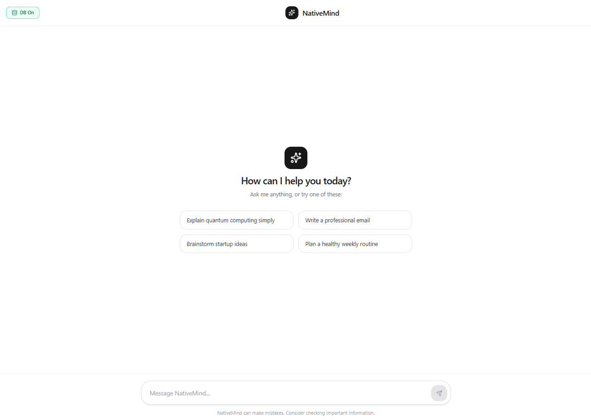
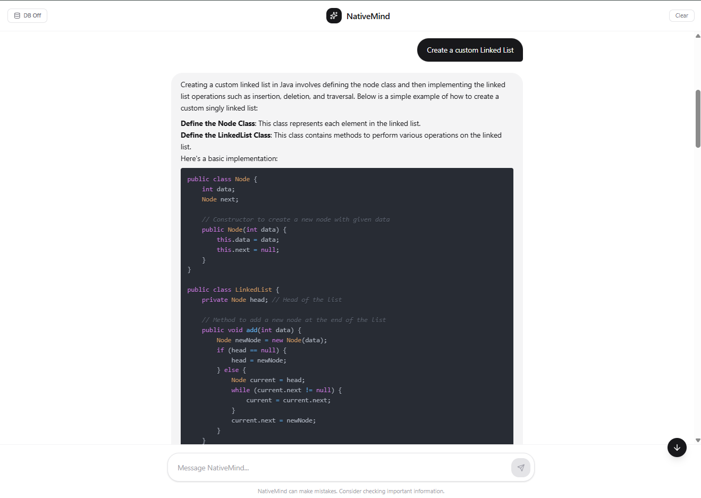
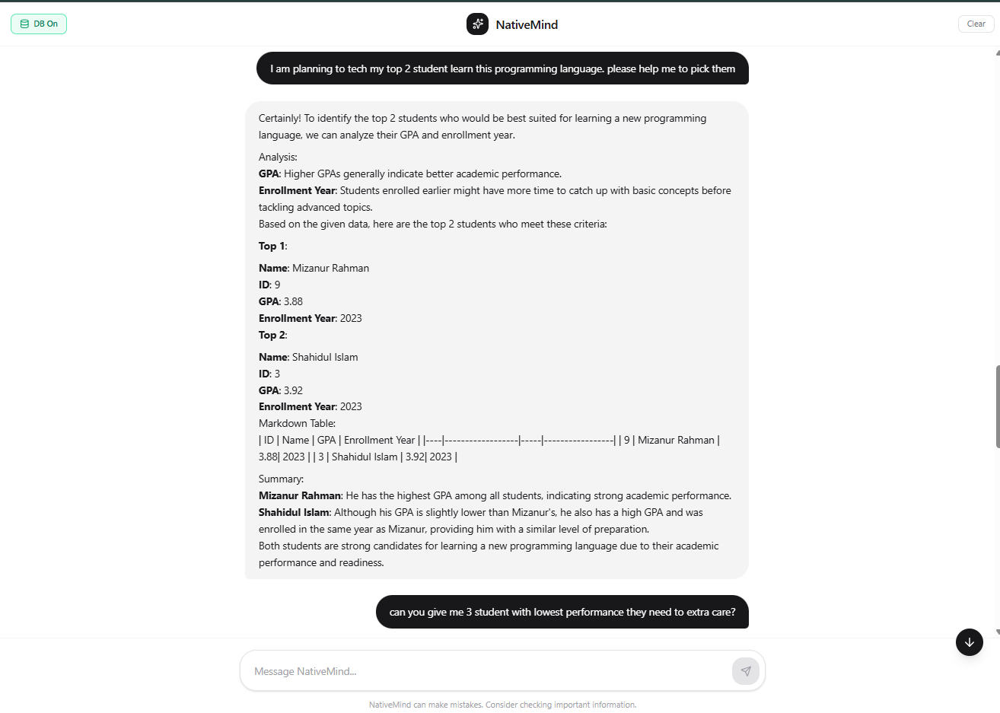

# NativeMind — Local LLM Chat Interface

A fast, privacy-first chat interface that runs **entirely on your own machine** using [Ollama](https://ollama.com) as the local model backend. No cloud, no API keys, no data leaving your computer.

Built with **React 19**, **Vite 7**, **TypeScript**, and **Tailwind CSS 4**, NativeMind streams responses token-by-token and renders rich **Markdown with syntax highlighting** out of the box.

---

## ✨ Features

- 🧠 **Fully local LLM** — talks to an Ollama server on `localhost:11434`; nothing is sent to the cloud.
- ⚡ **Streaming responses** — tokens appear in real time as the model generates them.
- 📝 **Markdown rendering** — headings, lists, tables, and inline formatting via `react-markdown`.
- 💻 **Syntax highlighting** — code blocks rendered with `react-syntax-highlighter` (One Dark theme).
- 💾 **Conversation persistence** — chats and model context survive page refreshes (localStorage).
- 🧹 **Clear conversation** — reset the current thread and its context with one click.
- 💡 **Suggested prompts** — one-click starters on the empty state.
- 📜 **Scroll-to-bottom** — auto-scroll plus a floating button when you scroll up.
- 🗄️ **Database mode** — injects a bundled student dataset into the prompt so the model can analyze data and answer structured questions.

## 📸 Screenshots

> **Empty state** with suggested prompt cards.



> **Chatting with NativeMind** — streaming markdown response.



> **Database mode** — analyzing the students dataset.



---

## 🚀 Getting Started

### Prerequisites

- [Node.js](https://nodejs.org) **18+** (project uses Vite 7)
- [Ollama](https://ollama.com/download) installed and running
- At least one model pulled, e.g. `qwen2.5-coder` or `deepseek-coder`

### 1. Install Ollama & pull a model

```bash
# Start the Ollama server (background daemon on http://localhost:11434)
ollama serve

# Pull a model (in a separate terminal)
ollama pull qwen2.5-coder:latest
```

### 2. Configure environment variables

Create a `.env` file in the project root (a template is already present):

```env
# Model to use for chat
VITE_MODEL=qwen2.5-coder:latest

# Ollama server URL
VITE_BOT_URL=http://localhost:11434
```

| Variable        | Description                        | Default                  |
| --------------- | ---------------------------------- | ------------------------ |
| `VITE_MODEL`    | Name of the Ollama model to use    | `qwen2.5-coder:latest`   |
| `VITE_BOT_URL`  | Base URL of the Ollama server      | `http://localhost:11434` |

### 3. Install dependencies & run

```bash
# Install dependencies
npm install

# Start the dev server
npm run dev
```

Open the printed URL (usually `http://localhost:5173`) in your browser.

---

## 🧑‍💻 Usage

1. **Start a conversation** — type a message or click one of the suggested prompts.
2. **Watch the stream** — responses render as they are generated, with full Markdown and code highlighting.
3. **Toggle Database mode** — click the **`DB Off` / `DB On`** button in the header. When **ON**, the bundled `students` dataset (`public/db/students.json`) is injected into every prompt so the model can answer data-analysis questions with structured tables and insights.
4. **Clear the thread** — click **`Clear`** in the header to reset messages and context.

> ⚠️ NativeMind can make mistakes. Consider checking important information.

---

## 🗄️ Database Mode

When **Database mode** is enabled, the app preloads the registered JSON databases from `src/utils/db.ts` and prepends them to the user's prompt as context:

- `students` — student records with personal info, enrollment, GPA, and status (`public/db/students.json`).

The generated prompt instructs the model to behave as a **data analyst** and respond with Markdown tables, bullet points, headings, and highlighted insights. Example questions:

> "What is the average GPA of Computer Science students?"<br>
> "List the students with a GPA above 3.7 in a table."

---

## 🏗️ Project Structure

```
Local-LLM/
├── public/
│   ├── ai-avatar.png          # Avatar asset
│   └── db/
│       ├── students.json      # Students dataset (used in DB mode)
│       ├── subjects.json      # Subjects reference data
│       └── results.json       # Exam results reference data
├── src/
│   ├── components/
│   │   └── EmptyArea.tsx      # Empty state with suggested prompts
│   ├── config/
│   │   └── index.ts           # Reads VITE_* env variables
│   ├── types/
│   │   └── index.ts           # Message & Ollama response types
│   ├── utils/
│   │   ├── cn.ts              # className merge helper
│   │   ├── db.ts              # Database registry & fetchers
│   │   └── Storage.ts         # localStorage persistence helpers
│   ├── App.tsx                # Main chat UI & streaming logic
│   ├── main.tsx               # React entry point
│   └── index.css              # Tailwind + global styles
├── md/                        # README screenshots (s1.png, s2.png, s3.png)
├── .env                       # Local config (gitignored)
├── index.html
├── package.json
├── vite.config.ts
└── tsconfig.json
```

---

## 🛠️ Scripts

| Script      | Description                          |
| ----------- | ------------------------------------ |
| `npm run dev`     | Start the Vite dev server            |
| `npm run build`   | Build the production bundle          |
| `npm run preview` | Preview the built production bundle  |

The build uses [`vite-plugin-singlefile`](https://github.com/richardtallent/vite-plugin-singlefile) to inline all JS/CSS into a single `dist/index.html` for easy distribution.

---

## 🧰 Tech Stack

- [React](https://react.dev) 19
- [Vite](https://vitejs.dev) 7
- [TypeScript](https://www.typescriptlang.org) 5
- [Tailwind CSS](https://tailwindcss.com) 4
- [react-markdown](https://github.com/remarkjs/react-markdown) + [react-syntax-highlighter](https://github.com/react-syntax-highlighter/react-syntax-highlighter)
- [lucide-react](https://lucide.dev) — icons
- [Ollama](https://ollama.com) — local model backend

---

## 📄 License

This project is for educational / personal use. See the `LICENSE` file (if present) for details.
